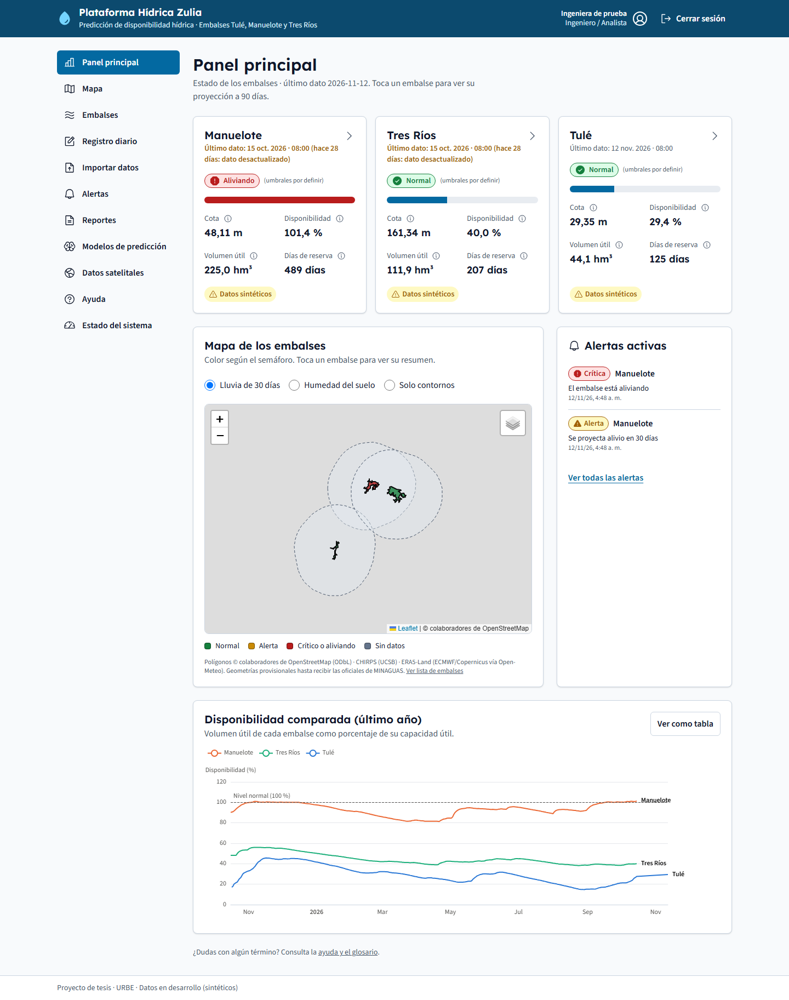

# Plataforma Hídrica Zulia

Plataforma web con Machine Learning y datos satelitales para predecir la disponibilidad hídrica de los embalses **Tulé, Manuelote y Tres Ríos** (estado Zulia, Venezuela).

Tesis de Ingeniería en Informática, Universidad Privada Dr. Rafael Belloso Chacín (URBE).
Autores: Hunaldo Hernández y Angie Rubistein. Tutores: Miguel Vílchez y Maribel Ordóñez.

> ⚠️ Los datos de `ml/data/synthetic/` son **sintéticos** y solo sirven para el desarrollo. No representan mediciones reales de MINAGUAS.

## Estado
Iteraciones 0 a 8 cerradas: los módulos M1–M12 están implementados y probados con datos **sintéticos**. Pendiente: probar Docker y desplegar (P-32), y cargar los datos oficiales de MINAGUAS.



## Documentación
- [docs/manual-usuario.md](docs/manual-usuario.md): manual de usuario por rol, con capturas
- [docs/manual-tecnico.md](docs/manual-tecnico.md): instalación, despliegue (Docker, Vercel), respaldo, CLI y variables
- [docs/arquitectura.md](docs/arquitectura.md) · [docs/historias-de-usuario.md](docs/historias-de-usuario.md) · [docs/diccionario-datos.md](docs/diccionario-datos.md) · [docs/api/endpoints.md](docs/api/endpoints.md)
- [ml/reports/backtesting.md](ml/reports/backtesting.md): evaluación de los modelos de predicción
- [CLAUDE.md](CLAUDE.md): decisiones del proyecto y forma de trabajo
- [docs/CAMBIOS-PROMPT.md](docs/CAMBIOS-PROMPT.md): cambios respecto a los requerimientos originales
- [docs/PENDIENTES.md](docs/PENDIENTES.md): datos y fórmulas por confirmar con MINAGUAS
- [docs/herramientas-ia.md](docs/herramientas-ia.md): herramientas de IA usadas en el desarrollo

## Requisitos de desarrollo
- Python 3.12 (gestionado con [uv](https://docs.astral.sh/uv/))
- Node.js 22+
- PostgreSQL 18 + PostGIS

## Puesta en marcha (desarrollo local)

```powershell
# 1. Configuración
copy .env.example .env        # completa DB_PASSWORD y JWT_SECRET

# 2. Base de datos (pide la contraseña de postgres)
powershell -ExecutionPolicy Bypass -File scripts\db\setup_db.ps1
cd backend; uv sync; uv run alembic upgrade head; cd ..

# 3. Backend  → http://localhost:8000/docs
cd backend; uv run uvicorn app.main:app --reload

# 4. Frontend → http://localhost:5173   (en otra terminal)
cd frontend; npm install; npm run dev

# Verificación completa (lint + pruebas)
powershell -ExecutionPolicy Bypass -File scripts\check.ps1
```
