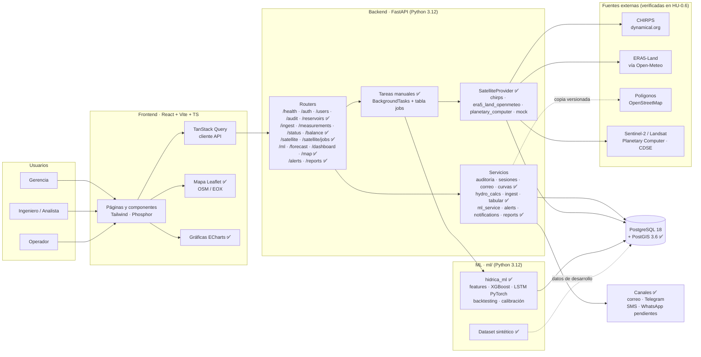
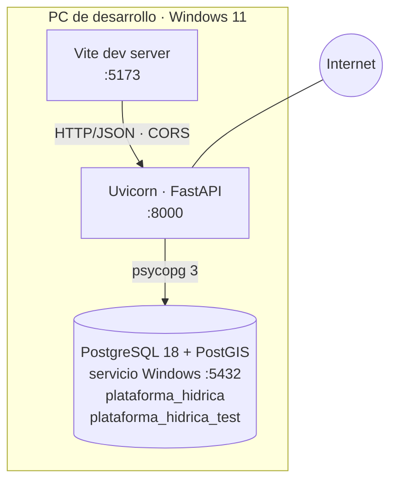
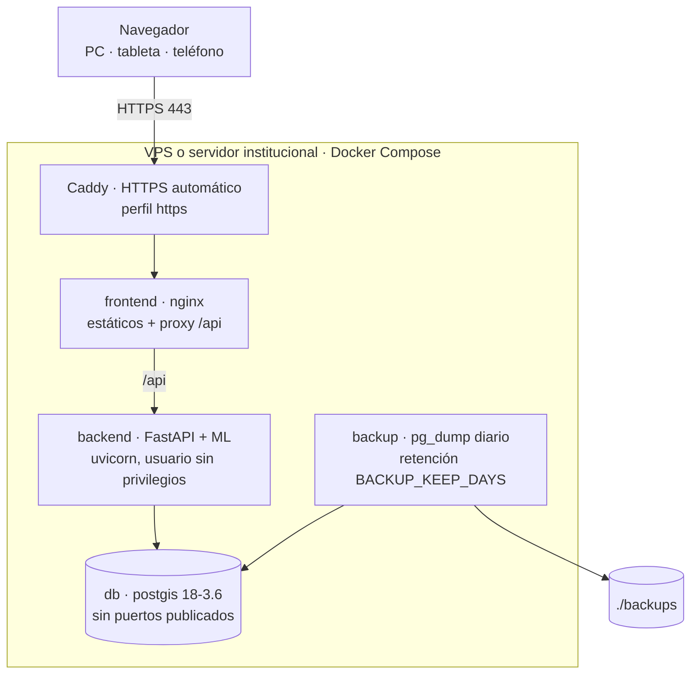
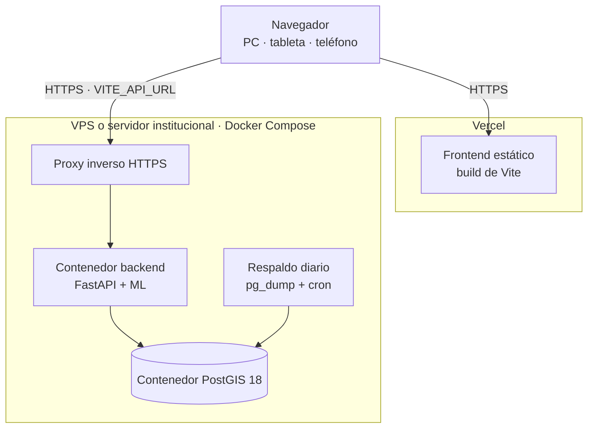
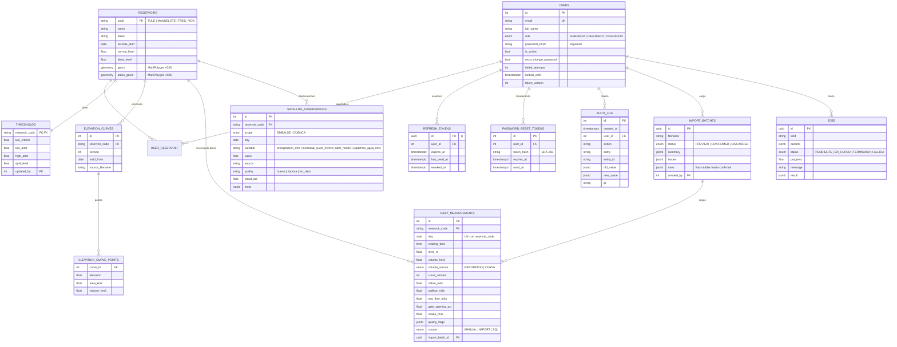
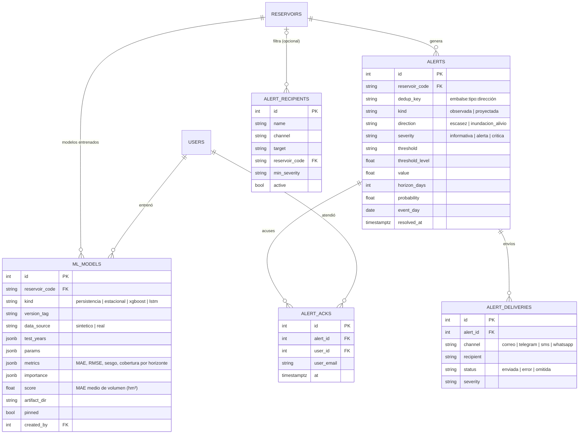
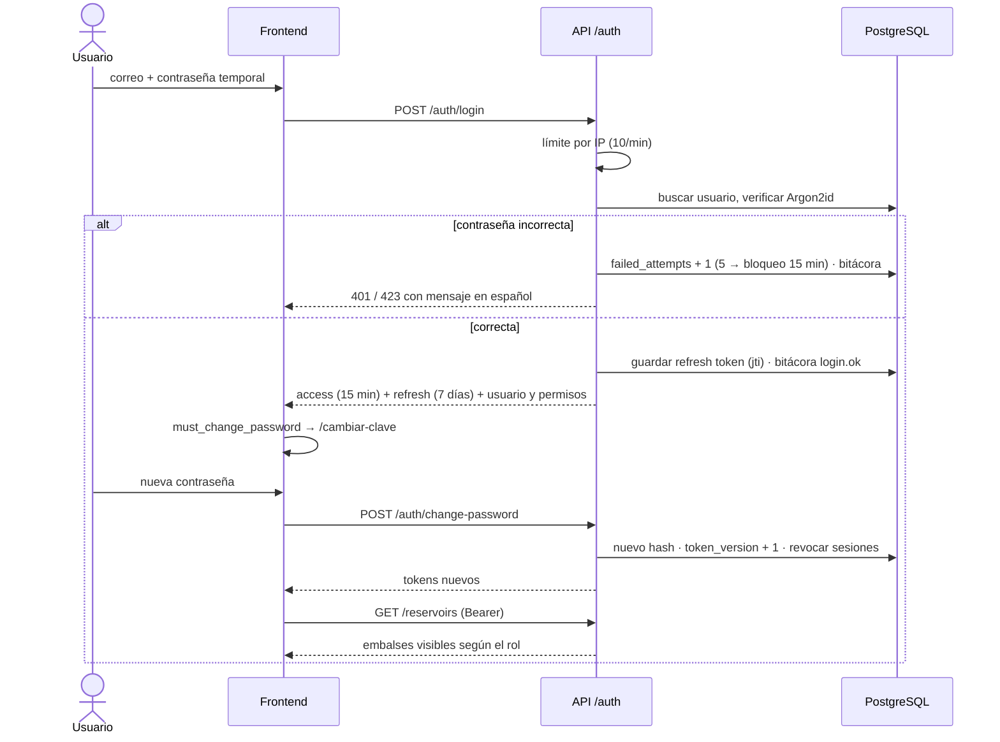
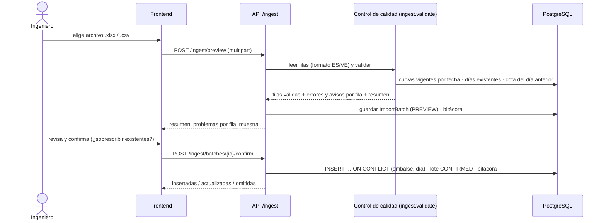
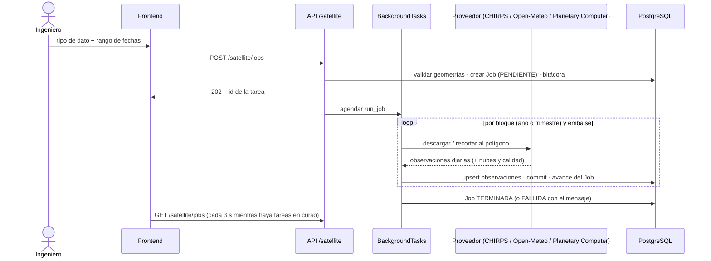
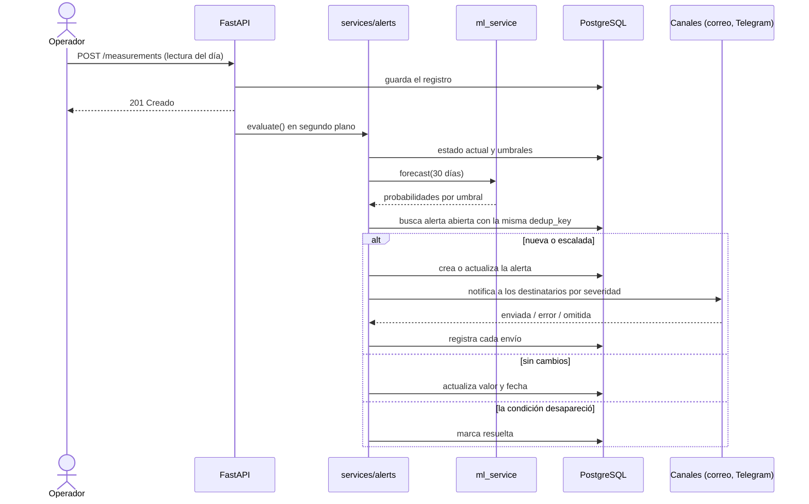

# Arquitectura

Documento vivo: se actualiza al cerrar cada iteración. **Estado: cierre de la Iteración 8 (2026-11-12).** Todos los módulos M1–M12 están implementados; lo que depende de terceros (proveedor de SMS/WhatsApp, datos oficiales) está marcado como pendiente.

## 1. Arquitectura lógica (componentes)

## 2. Arquitectura física

### 2.1 Desarrollo (actual)

### 2.2 Producción (Iteración 7 · archivos listos, sin desplegar)

Hay dos variantes. Los archivos están escritos (`docker-compose.yml`, `backend/Dockerfile`, `frontend/Dockerfile`, `frontend/nginx.conf`, `frontend/vercel.json`) pero Docker no estaba instalado en el equipo de desarrollo y no había cuentas de VPS ni Vercel (P-32).

**Variante A — todo en un servidor (recomendada para MINAGUAS):**

**Variante B — frontend en Vercel:**

Si las normativas de la institución lo exigen (P-16), el frontend también se puede servir desde el mismo servidor institucional y prescindir de Vercel.

## 3. Modelo de datos (entidad-relación)

Tablas **implementadas** en la Iteración 1 (migración `0002_auth_reservoirs`):

Tablas agregadas en las Iteraciones 4 y 6 (migraciones `0005` y `0006_alerts`):

Las predicciones **no se guardan**: se calculan al consultar con el modelo activo (en caché) y así siempre usan el último dato. El diccionario completo de columnas está en [diccionario-datos.md](diccionario-datos.md).

## 4. Casos de uso (Iteración 1)

## 5. Secuencia: inicio de sesión con primer acceso

## 6. Secuencia: importación con vista previa (Iteración 2)

## 7. Secuencia: descarga satelital en segundo plano (Iteración 3)

## 8. Decisiones de arquitectura

| Decisión | Razón |
|---|---|
| `create_app(settings)` como fábrica | Permite probar con otra configuración (base de pruebas, puerto inválido para el error 503) sin variables globales. |
| Contraseña como `SecretStr` y error 503 sin detalle del driver | Evita filtrar credenciales en las respuestas y en los logs. |
| `SatelliteProvider` abstracto | Cambiar de fuente sin tocar la ingesta ni el ML (C-10, C-12). |
| Plantilla de importación definida en un solo lugar (`ml/src/schema.py`) | El dataset sintético y los datos reales comparten el mismo formato. |
| Variables `VITE_*` desde el `.env` de la raíz | Una sola fuente de configuración; Vite no expone al navegador las variables sin prefijo. |
| `token_version` en el usuario | Cambiar la contraseña, desactivar o cambiar el rol invalida al instante todos los tokens emitidos, sin listas negras. |
| Rotación de refresh tokens con detección de reuso | Si alguien roba un token de renovación y lo usa, la segunda vez se detecta y se cierran todas las sesiones. |
| Permisos en una matriz declarativa (`core/permissions.py`) | Refleja literalmente la tabla de la sección 6. El backend la aplica con `require()` y el frontend la recibe en `/auth/me`. |
| Errores con `{"detail": {"code", "message"}}` | El frontend muestra el mensaje en español y decide según el código (p. ej. `PASSWORD_CHANGE_REQUIRED`). |
| Curvas versionadas por fecha de vigencia | Los cálculos históricos usan la curva que regía en cada fecha, no la última cargada. |
| Un solo validador para importación, registro manual, corrección y carga sintética | Las reglas de calidad son idénticas en todos los caminos de entrada y se prueban una sola vez. |
| Vista previa persistida (`import_batches`) | El archivo se valida una vez; al confirmar se guarda exactamente lo que el usuario revisó. |
| Indicadores M12 calculados al consultar (no guardados) | Si cambia la curva o se corrige una fórmula, todo el histórico se recalcula sin migrar datos. |
| Proveedores satelitales detrás de `SatelliteProvider`; cálculos en `compute.py` (sin red) | Cambiar de fuente (p. ej. al CDS con cuenta) no toca la ingesta ni la API, y los cálculos se prueban con arreglos sintéticos. |
| Copia versionada de los polígonos OSM (`app/data/geo`) | El sistema no depende de que OSM o Nominatim estén disponibles, y la geometría usada queda trazable. |
| Tareas con `BackgroundTasks` + tabla `jobs` | Descargas de minutos u horas sin bloquear la API, con avance visible y sin instalar Redis ni Celery. |
| Fórmulas en funciones puras (`hydro_calcs.py`) | Se auditan y prueban sin base de datos. Es el único lugar que hay que cambiar cuando MINAGUAS valide las fórmulas. |
| Paquete `hidrica_ml` compartido por el backend y los cuadernos | Las features y los modelos de la tesis son exactamente los que corren en producción. |
| Registro de modelos propio (`ml_models` + archivos) en lugar de MLflow | Un servidor menos que mantener; cumple lo necesario (versiones, métricas, activo, fijado). |
| Selección automática por MAE, incluida la línea base | Si el ML no supera a la línea base estacional, se usa la línea base: honestidad frente al usuario. |
| Calibración conformal de las bandas | Las bandas de XGBoost y LSTM se ajustan con los residuos de validación para acercarse al 80 % nominal. |
| Alertas con `dedup_key` y escalamiento | Una alerta por evento: no inunda de mensajes a la Gerencia y sí avisa cuando la situación empeora. |
| Canales detrás de `NotificationChannel` | Agregar SMS o WhatsApp es implementar una clase, sin tocar la lógica de alertas. |
| Reportes con ReportLab (sin dependencias del sistema) | Funciona igual en Windows, en Docker slim y en el servidor institucional. |
| Frontend servido por nginx con proxy `/api` | Mismo origen en producción: sin CORS ni cookies de terceros. |

## 9. Secuencia: evaluación de alertas (Iteración 6)

