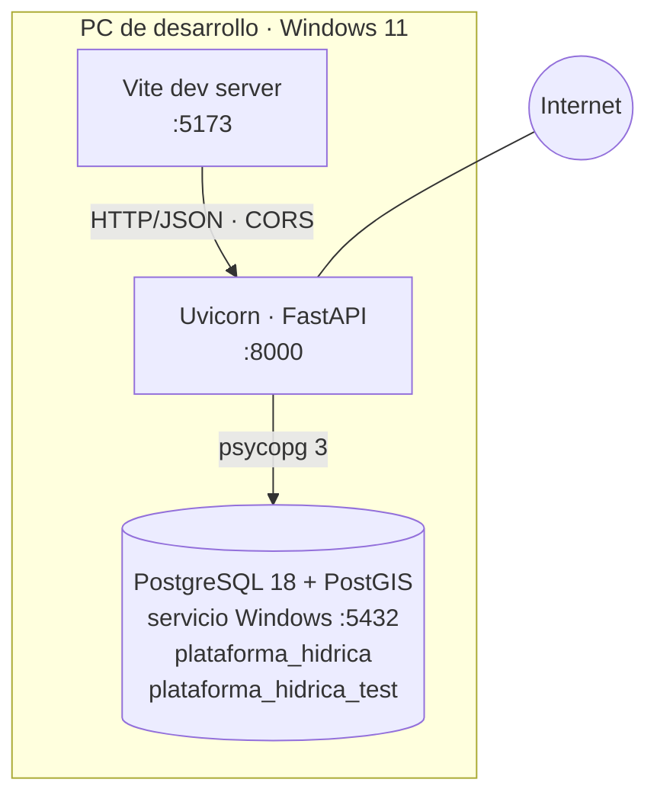
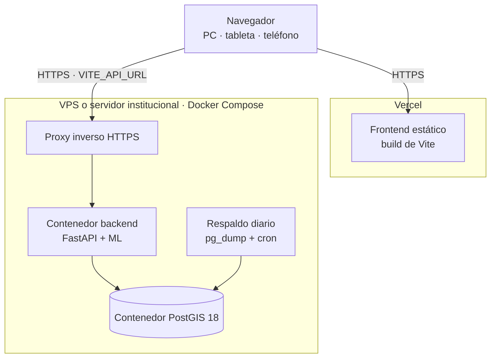
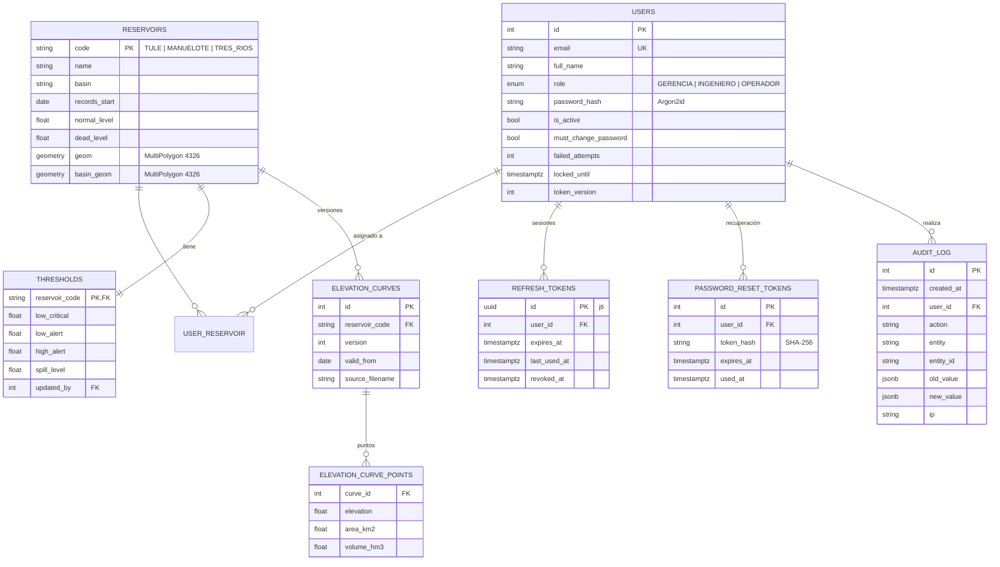
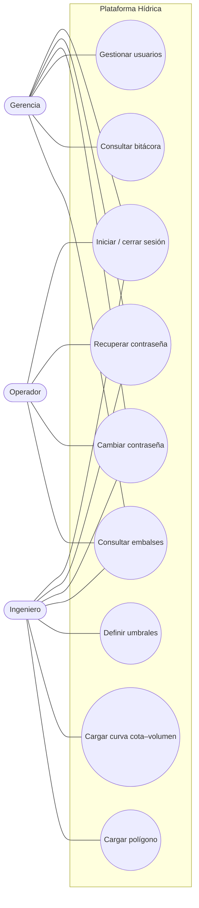
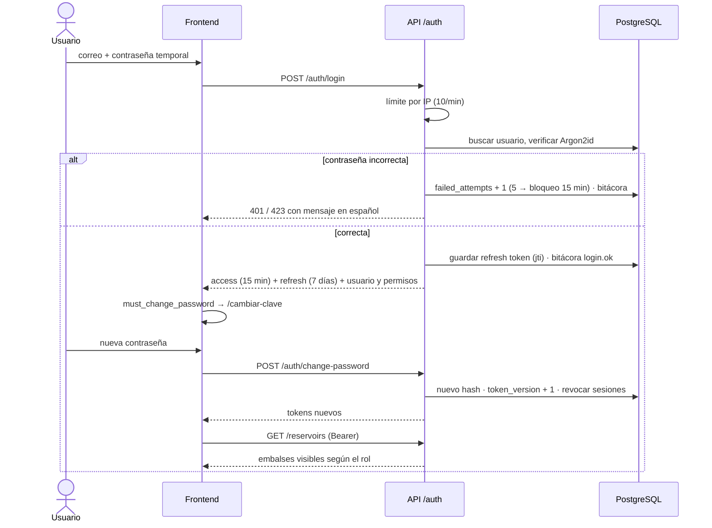

# Arquitectura

Documento vivo: se actualiza al cerrar cada iteración. **Estado: cierre de la Iteración 1 (2026-11-12).** Los bloques marcados *(previsto)* todavía no existen.

## 1. Arquitectura lógica (componentes)

```mermaid
flowchart LR
    subgraph Usuarios
        G[Gerencia]
        I[Ingeniero / Analista]
        O[Operador]
    end

    subgraph Frontend["Frontend · React + Vite + TS"]
        UI[Páginas y componentes<br/>Tailwind · Phosphor]
        Q[TanStack Query<br/>cliente API]
        MAP[Mapa Leaflet<br/>OSM / EOX <i>(previsto)</i>]
    end

    subgraph Backend["Backend · FastAPI (Python 3.12)"]
        API[Routers<br/>/health · /auth · /users · /audit · /reservoirs ✅<br/>ingesta · predicciones · alertas · reportes <i>(previsto)</i>]
        SVC[Servicios<br/>auditoría · sesiones · correo · curvas ✅<br/>hydro_calcs · alertas · reportes <i>(previsto)</i>]
        SAT[SatelliteProvider ✅<br/>mock · chirps · era5_land · copernicus · planetary_computer]
        JOBS[Tareas manuales<br/>BackgroundTasks <i>(previsto)</i>]
    end

    subgraph ML["ML · ml/ (Python 3.12)"]
        SYN[Dataset sintético ✅]
        FEAT[features · XGBoost · LSTM PyTorch<br/>backtesting · registro <i>(previsto)</i>]
    end

    DB[(PostgreSQL 18<br/>+ PostGIS 3.6 ✅)]

    subgraph Externos["Fuentes externas (verificadas en HU-0.6)"]
        CH[CHIRPS<br/>dynamical.org]
        E5[ERA5-Land<br/>Copernicus CDS]
        S2[Sentinel-2 / Landsat<br/>Planetary Computer · CDSE]
    end

    G & I & O --> UI
    UI --> Q --> API
    UI --> MAP
    API --> SVC --> DB
    API --> JOBS --> SAT
    JOBS --> FEAT
    SAT --> CH & E5 & S2
    SAT --> DB
    FEAT --> DB
    SYN -. datos de desarrollo .-> DB
```

## 2. Arquitectura física

### 2.1 Desarrollo (actual)



### 2.2 Producción (previsto, Iteración 7)



Si las normativas de la institución lo exigen (P-16), el frontend también se puede servir desde el mismo servidor institucional y prescindir de Vercel.

## 3. Modelo de datos (entidad-relación)

Tablas **implementadas** en la Iteración 1 (migración `0002_auth_reservoirs`):



Previstas para las próximas iteraciones: `MEDICION_DIARIA` (M4), `OBSERVACION_SATELITAL` (M5), `MODELO_ML` y `PREDICCION` (M6), `ALERTA` (M9).

## 4. Casos de uso (Iteración 1)



## 5. Secuencia: inicio de sesión con primer acceso



## 6. Decisiones de arquitectura

| Decisión | Razón |
|---|---|
| `create_app(settings)` como fábrica | Permite probar con otra configuración (base de pruebas, puerto inválido para el error 503) sin variables globales. |
| Contraseña como `SecretStr` y error 503 sin detalle del driver | Evita filtrar credenciales en las respuestas y en los logs. |
| `SatelliteProvider` abstracto | Cambiar de fuente sin tocar la ingesta ni el ML (C-10, C-12). |
| Plantilla de importación definida en un solo lugar (`ml/src/schema.py`) | El dataset sintético y los datos reales comparten el mismo formato. |
| Variables `VITE_*` desde el `.env` de la raíz | Una sola fuente de configuración; Vite no expone al navegador las variables sin prefijo. |
| `token_version` en el usuario | Cambiar la contraseña, desactivar o cambiar el rol invalida al instante todos los tokens emitidos, sin listas negras. |
| Rotación de refresh tokens con detección de reuso | Si alguien roba un token de renovación y lo usa, la segunda vez se detecta y se cierran todas las sesiones. |
| Permisos en una matriz declarativa (`core/permissions.py`) | Refleja literalmente la tabla de la sección 6. El backend la aplica con `require()` y el frontend la recibe en `/auth/me`. |
| Errores con `{"detail": {"code", "message"}}` | El frontend muestra el mensaje en español y decide según el código (p. ej. `PASSWORD_CHANGE_REQUIRED`). |
| Curvas versionadas por fecha de vigencia | Los cálculos históricos usan la curva que regía en cada fecha, no la última cargada. |
