# Manual de usuario · Plataforma Hídrica Zulia

Plataforma web para consultar el estado y la proyección a 90 días de los embalses **Tulé, Manuelote y Tres Ríos** (MINAGUAS, estado Zulia).

> **Importante:** mientras no se carguen los datos oficiales, la plataforma muestra **datos sintéticos** (simulados) con la etiqueta amarilla "Datos sintéticos". No se deben usar para decisiones de operación.

Las capturas de este manual están en [`docs/capturas/`](capturas/) y se regeneran desde `frontend/` con `$env:CAPTURAS=1; npx playwright test e2e/capturas.spec.ts --project=escritorio`.

---

## 1. Roles y qué puede hacer cada uno

| Acción | Gerencia | Ingeniero / Analista | Operador |
|---|:---:|:---:|:---:|
| Ver el panel, el mapa, las fichas y las proyecciones | ✅ todos los embalses | ✅ embalses asignados | ✅ embalses asignados |
| Registrar la lectura diaria | — | ✅ | ✅ |
| Importar históricos (Excel o CSV) | — | ✅ | — |
| Configurar umbrales y curvas cota–volumen | — | ✅ | — |
| Descargar datos satelitales y entrenar modelos | — | ✅ | — |
| Ver alertas y marcarlas como atendidas | ✅ | ✅ | ✅ |
| Evaluar alertas y configurar destinatarios | — | ✅ | — |
| Descargar reportes | ✅ | ✅ | — |
| Gestionar usuarios y ver la bitácora | ✅ | — | — |

El menú lateral solo muestra las opciones que corresponden al rol. En el teléfono, el menú se abre con el botón **☰ Abrir menú**.

---

## 2. Inicio de sesión

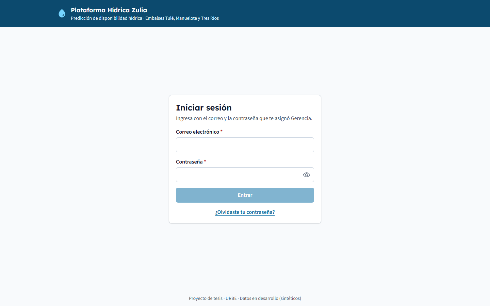

1. Escribe tu **correo institucional** y tu **contraseña**, y pulsa **Entrar**.
2. **Primer acceso:** la plataforma te pide cambiar la contraseña temporal. La nueva debe tener al menos 10 caracteres.
3. **¿Olvidaste la contraseña?** Usa el enlace de la pantalla de inicio; recibirás un correo con un enlace que vence en poco tiempo.
4. Tras **5 intentos fallidos**, la cuenta se bloquea durante 15 minutos.
5. La sesión se cierra sola tras **30 minutos sin actividad**. Para salir, usa **Cerrar sesión** (arriba a la derecha).

---

## 3. Panel principal

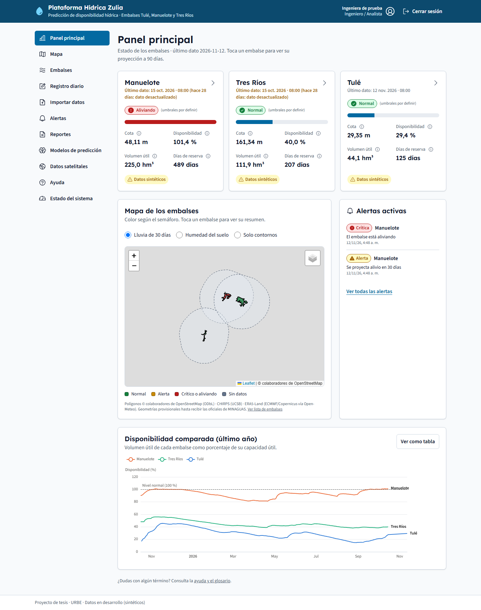

Es la primera pantalla después de entrar.

- **Tarjetas de los embalses.** Cada tarjeta muestra:
  - el **semáforo**: Normal (verde), Alerta (amarillo), Crítico o aliviando (rojo) y Sin datos (gris);
  - la cota, la disponibilidad, el volumen útil y los días de reserva.

  Si el último dato tiene más de 2 días, aparece en naranja "dato desactualizado". Toca una tarjeta para abrir la ficha del embalse.
- **Mapa de los embalses**, con las capas de lluvia de 30 días, humedad del suelo o solo contornos (ver sección 5).
- **Alertas activas:** las más recientes, con su severidad. "Ver todas las alertas" lleva a la pantalla de alertas.
- **Disponibilidad comparada (último año):** el porcentaje de capacidad útil de cada embalse. Pasa el cursor sobre la gráfica para ver los valores; **Ver como tabla** muestra los mismos datos en una tabla.

El ícono **ⓘ** junto a cada indicador explica qué significa.

---

## 4. Ficha del embalse y proyección a 90 días

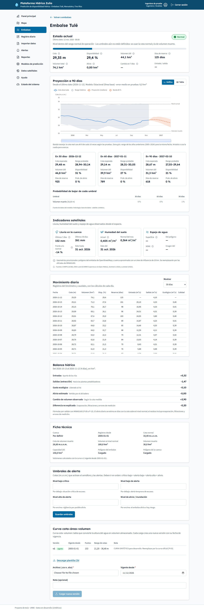

Se abre desde el panel, el mapa o **Embalses**. Contiene, de arriba abajo:

1. **Estado actual:** cota, disponibilidad, volumen útil y total, días de reserva, alivio y cambio en 7 días.
2. **Proyección a 90 días:**
   - **Línea azul:** la cota observada.
   - **Zona gris:** el rango histórico para esa fecha.
   - **Línea naranja:** la proyección (mediana). **Banda naranja:** el rango donde la cota real cayó 8 de cada 10 veces en las pruebas.
   - Las tarjetas de **30, 60 y 90 días** dan la cota esperada, el rango probable, la disponibilidad y la probabilidad de alivio.
   - La tabla **Probabilidad de bajar de cada umbral** indica la probabilidad de cruzar cada umbral a 30, 60 y 90 días.
   - El botón **Tabla** muestra los mismos datos sin gráfica.
3. **Indicadores satelitales:** lluvia de 7 y 30 días frente a lo normal, humedad del suelo y espejo de agua (NDWI).
4. **Movimiento diario:** los registros con sus cálculos. Elige el período en **Mostrar**.
5. **Balance hídrico:** entradas, salidas, gasto ecológico, alivio estimado y la diferencia no explicada.
6. **Ficha técnica**, **Umbrales de alerta** y **Curva cota–área–volumen**. Solo el Ingeniero puede editarlas.

---

## 5. Mapa

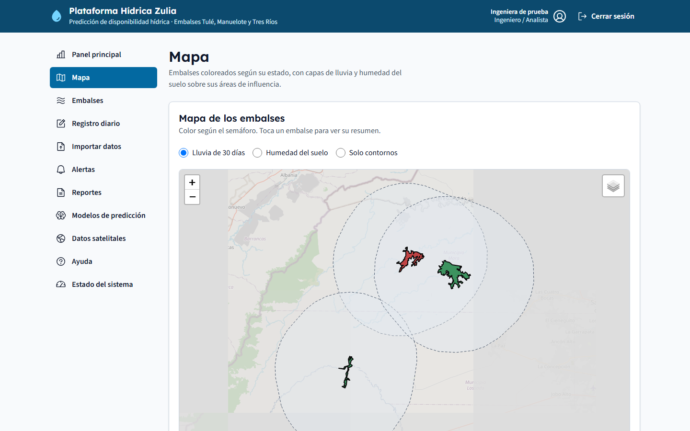

- Cada embalse aparece **coloreado según su semáforo**. La línea punteada marca su área de influencia (provisional: 20 km).
- **Capas:** *Lluvia de 30 días*, *Humedad del suelo* o *Solo contornos*.
- El botón de capas (arriba a la derecha) cambia el mapa base entre **OpenStreetMap** e **imagen satelital** (Sentinel-2 Cloudless, EOX).
- Toca un embalse para ver su resumen y el enlace a la ficha.

---

## 6. Registro diario (Operador e Ingeniero)

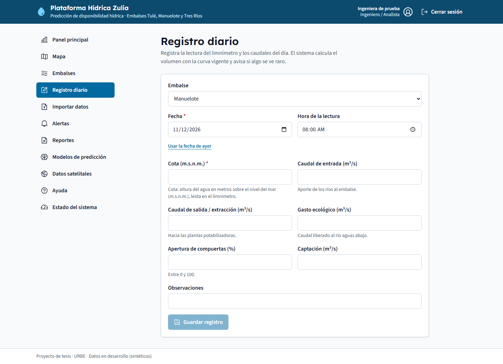

1. Elige el embalse (si tienes más de uno asignado) y la fecha. Por defecto aparece la de hoy.
2. Escribe la **cota** del limnímetro (m.s.n.m.) y los caudales en m³/s: **salida, entrada, gasto ecológico y captación**. Puedes usar coma decimal (por ejemplo, `29,35`).
3. Pulsa **Guardar registro**. La plataforma calcula el volumen, la disponibilidad y los días de reserva.
4. **Avisos de calidad:** si la cota sube o baja más de 1 m respecto al día anterior, o el valor está fuera de rango, aparece un aviso. Puedes corregirlo o confirmar que el dato es correcto.
5. Un Operador puede corregir sus propios registros durante 24 horas.

Al guardar, la plataforma **evalúa las alertas** automáticamente.

---

## 7. Importar datos (Ingeniero)

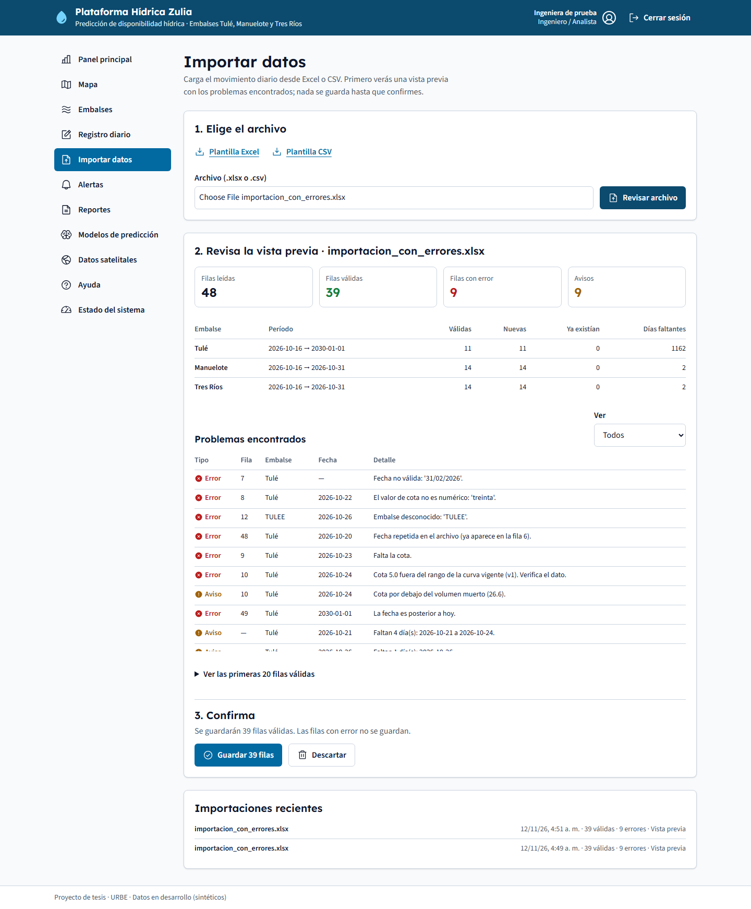

1. Descarga la **plantilla** (Excel o CSV) desde la misma pantalla.
2. Selecciona el archivo y pulsa **Revisar archivo**.
3. La **vista previa** muestra las filas válidas, las que tienen avisos y las que tienen errores, con el motivo de cada una.
4. Si todo está bien, pulsa **Confirmar importación**. Se guardan exactamente las filas que revisaste; las filas con error se omiten.

En `ml/data/synthetic/ejemplos/` hay archivos de ejemplo: uno válido, uno en formato venezolano y uno con errores a propósito.

---

## 8. Alertas

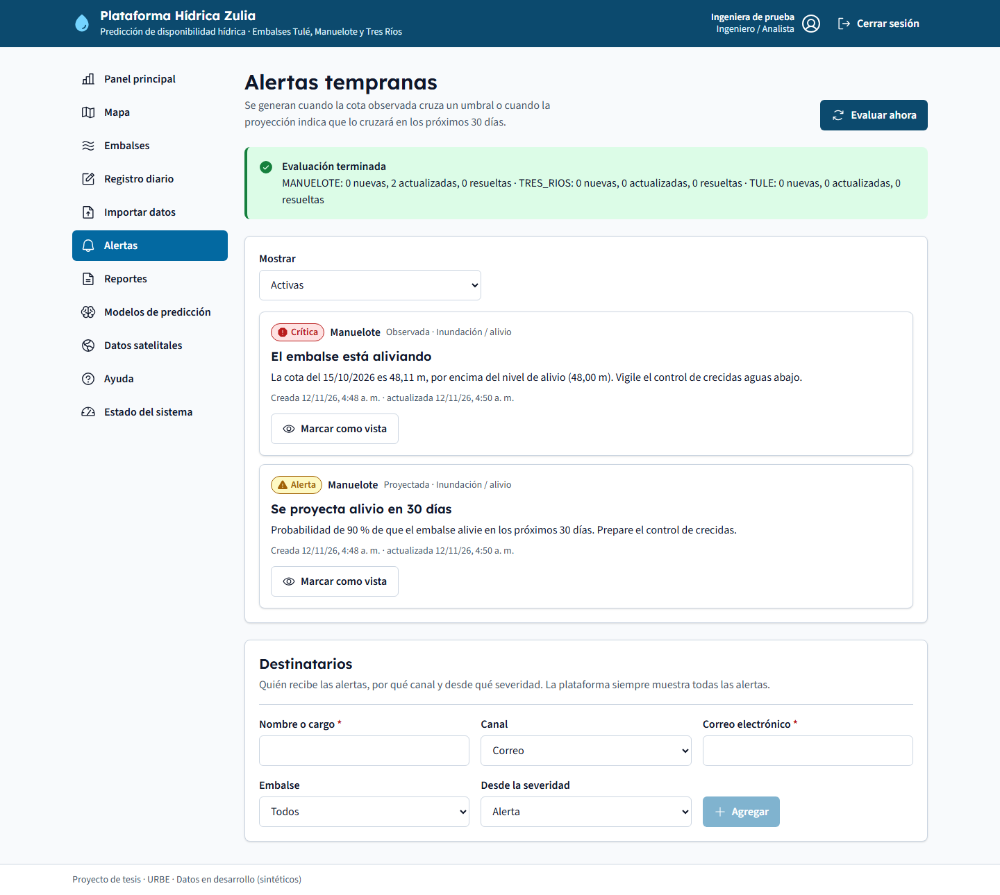

- **Severidades:** Informativa, Alerta y Crítica. Cada una se muestra con ícono y texto, además del color.
- **Tipos:**
  - **Observada:** el dato registrado ya cruzó un umbral.
  - **Proyectada:** el modelo estima una probabilidad alta de cruzarlo en los próximos 30 días.
- **Una alerta por evento:** si la situación continúa, la alerta se actualiza y no se repite. Si **empeora**, sube de severidad y se vuelve a notificar. Si desaparece, se marca como **resuelta**.
- **Marcar como atendida:** registra quién la atendió y cuándo.
- **Evaluar ahora** (Ingeniero) fuerza una evaluación inmediata. Normalmente se evalúa sola al registrar o importar datos.
- **Destinatarios (Ingeniero):** agrega nombre, canal (correo o Telegram), severidad mínima y embalse. El botón **Probar** envía un mensaje de prueba. SMS y WhatsApp aparecen como "proveedor pendiente".

Las destinatarias y los destinatarios previstos son el Ministro, el Viceministro y el Director Estadal (P-18).

---

## 9. Reportes

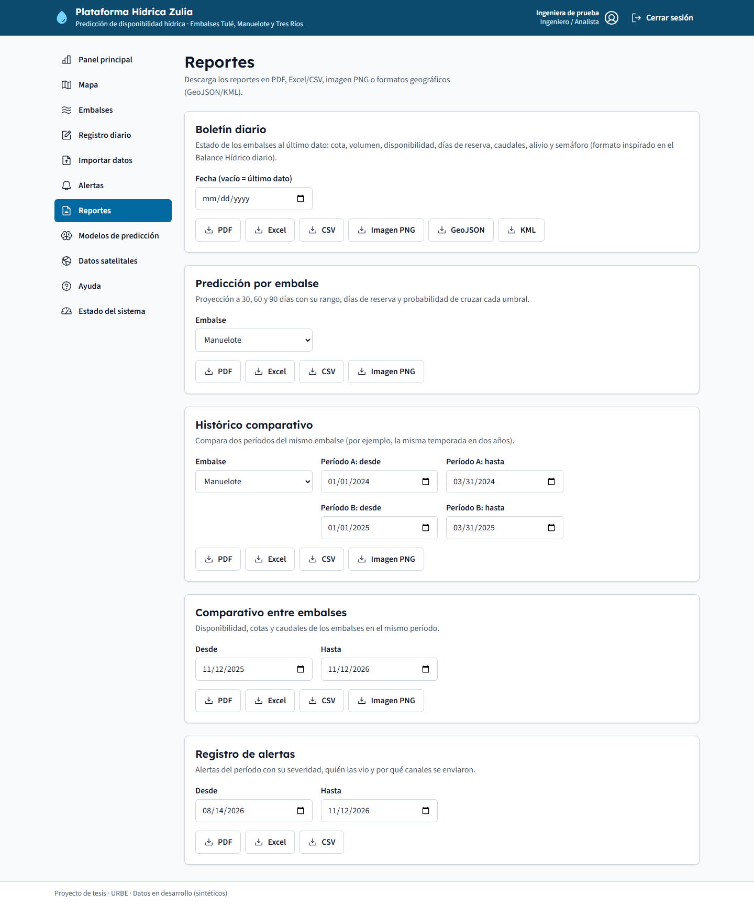

| Reporte | Contenido | Formatos |
|---|---|---|
| Boletín diario | Estado de los embalses al último dato (cota, volumen, disponibilidad, días de reserva, caudales, alivio y semáforo) | PDF, Excel, CSV, PNG, GeoJSON, KML |
| Predicción por embalse | Proyección a 30, 60 y 90 días | PDF, Excel, CSV, PNG |
| Histórico comparativo | Dos períodos del mismo embalse (por ejemplo, la misma temporada en dos años) | PDF, Excel, CSV, PNG |
| Comparativo entre embalses | Disponibilidad, cotas y caudales de los embalses en el mismo período | PDF, Excel, CSV, PNG |
| Registro de alertas | Alertas del período, quién las vio y por qué canales se enviaron | PDF, Excel, CSV |

GeoJSON y KML se abren en QGIS o Google Earth.

Los archivos CSV se abren directamente en Excel con los acentos correctos. Los reportes hechos con datos sintéticos lo indican en el encabezado.

---

## 10. Modelos de predicción y datos satelitales (Ingeniero)

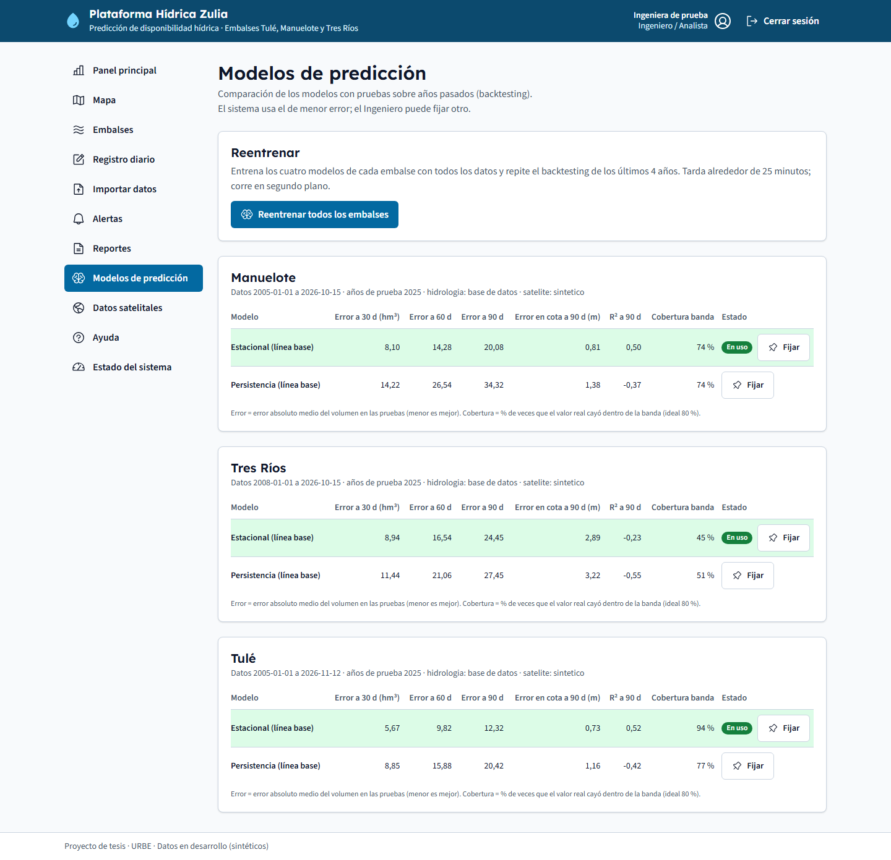

- **Modelos de predicción:**
  - Muestra, por embalse, el modelo activo, su error medio (MAE en hm³) a 30, 60 y 90 días, la cobertura de la banda y las variables más importantes.
  - **Entrenar** lanza el backtesting y el entrenamiento en segundo plano, con el avance visible. Al terminar, se activa el modelo con menor error, que puede ser una línea base.
  - **Fijar** obliga a usar un modelo concreto; **Soltar** vuelve a la selección automática.

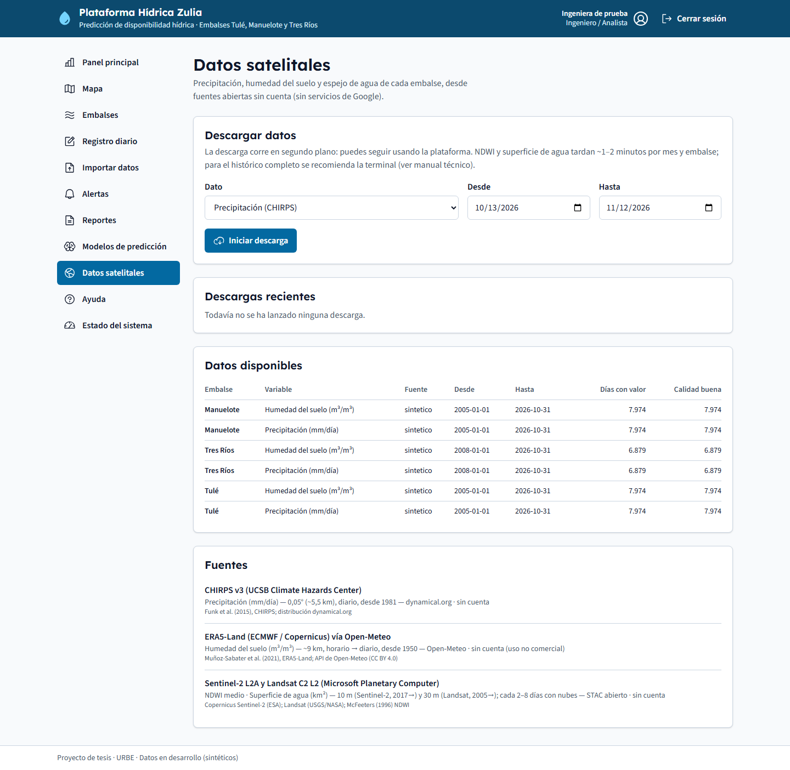

- **Datos satelitales:**
  - Descarga la lluvia (CHIRPS), la humedad del suelo (ERA5-Land) y el espejo de agua (Sentinel-2 y Landsat) para un rango de fechas.
  - Muestra el avance, la cobertura por variable y las fuentes.

---

## 11. Usuarios y bitácora (Gerencia)

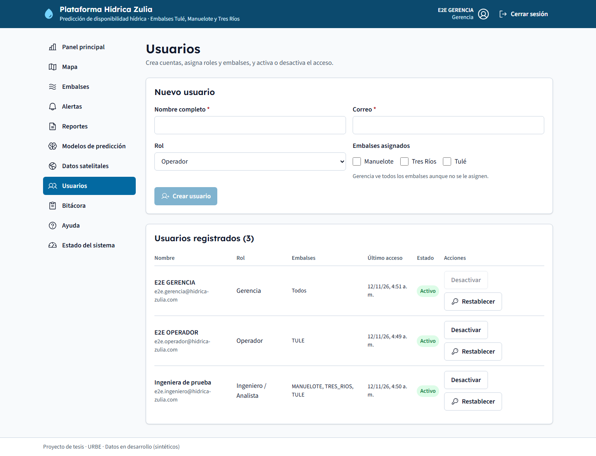

- **Usuarios:**
  - Crea un usuario con correo, nombre, rol y embalses asignados. Recibe una contraseña temporal.
  - Puedes cambiar el rol, desactivarlo o restablecer su contraseña. Cualquiera de estos cambios cierra sus sesiones abiertas.

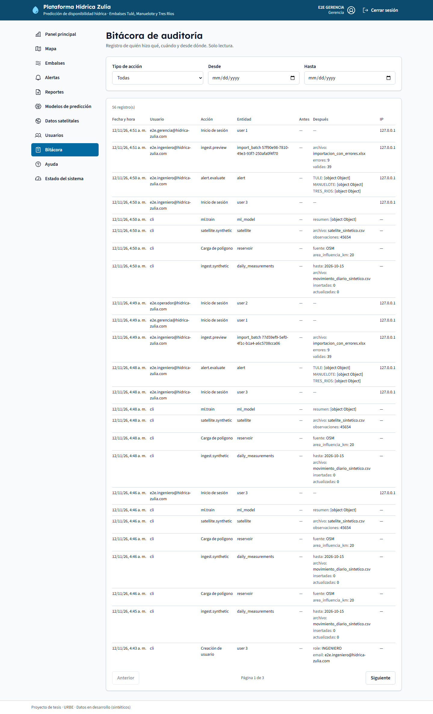

- **Bitácora:** registra quién hizo qué y cuándo: inicios de sesión, cambios de datos, umbrales, modelos y usuarios, con el valor anterior y el nuevo. Se puede filtrar por tipo de acción y por rango de fechas.

---

## 12. Uso en el teléfono

| Panel | Registro |
|---|---|
| 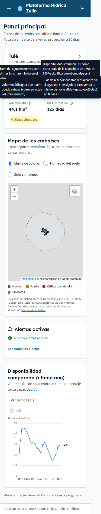 | 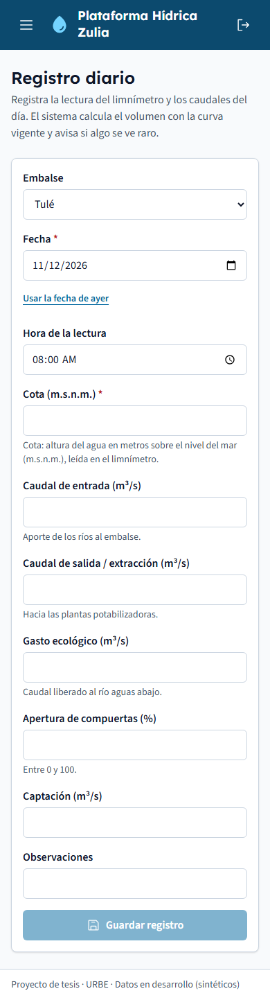 |

Todas las pantallas se adaptan al teléfono. El Operador puede registrar la lectura desde el propio embalse.

---

## 13. Ayuda y glosario

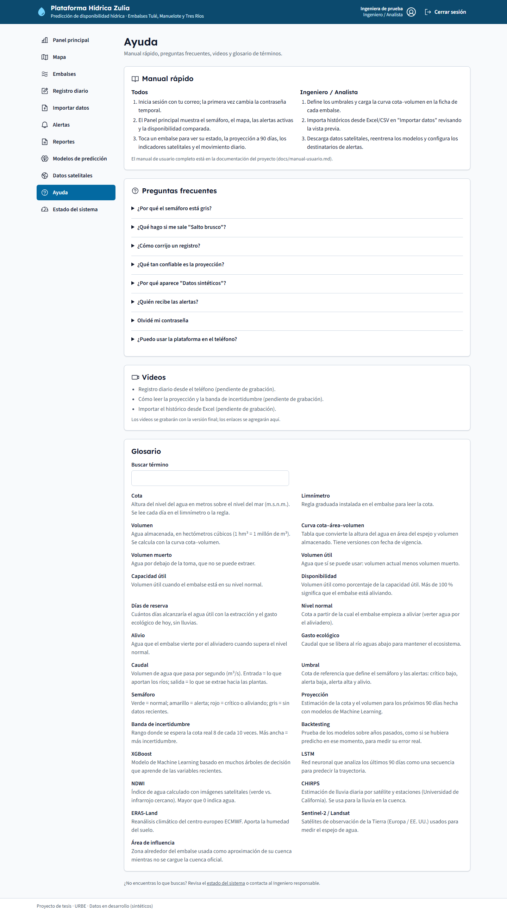

La opción **Ayuda** del menú tiene:
- un glosario con cota, volumen útil, volumen muerto, días de reserva, alivio, NDWI, CHIRPS, banda de incertidumbre y otros términos;
- una guía rápida por rol;
- preguntas frecuentes.

**Estado del sistema** indica si la base de datos y el servidor responden.
