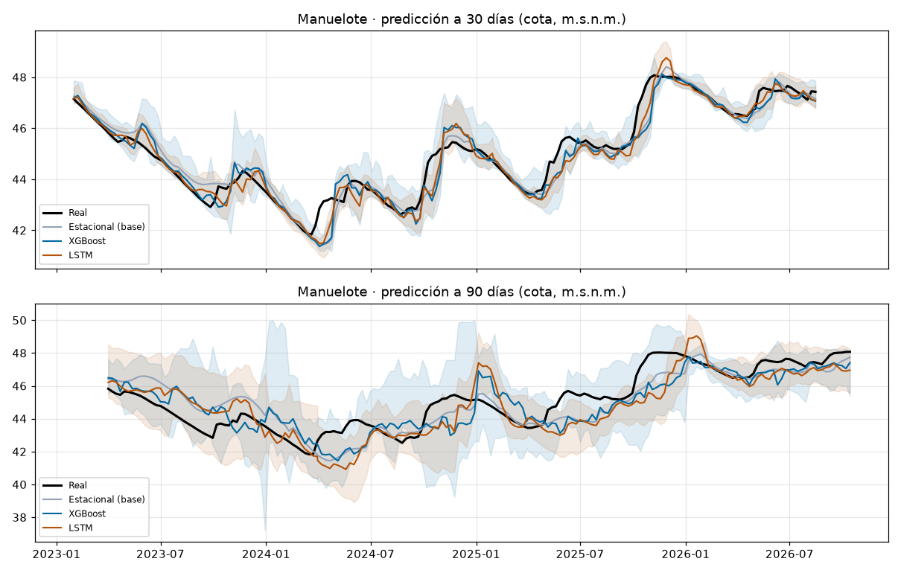
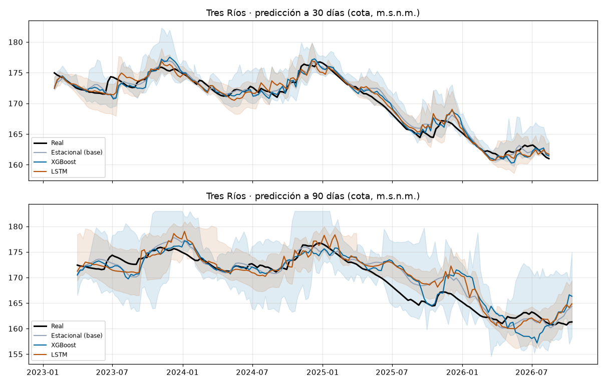
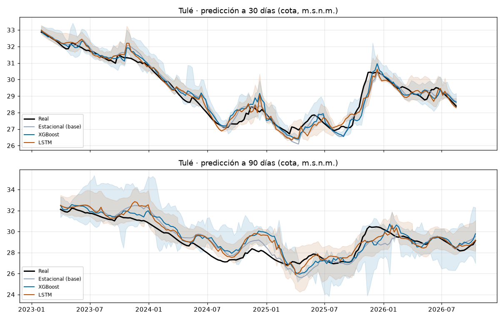

# Informe de backtesting de los modelos de predicción

Generado: 2026-11-12 04:25 · Plataforma Hídrica Zulia · objetivo 4 de la tesis.

> ⚠️ **Datos de desarrollo SINTÉTICOS.** La hidrología y (por defecto) la lluvia y la humedad del suelo
> son sintéticas y coherentes entre sí (C-24). Estas métricas validan el **método**; las cifras finales de
> la tesis se obtienen reentrenando con los históricos de MINAGUAS y las fuentes satelitales reales.

## Método

- **Validación con origen móvil (walk-forward):** para cada año de prueba se entrena con los datos hasta
  el 31/12 del año anterior y se predice desde orígenes semanales dentro del año; nunca se usa información futura.
- **Horizontes:** 30, 60 y 90 días. Se predice el cambio de volumen y se convierte a cota con la curva.
- **Métricas:** MAE, RMSE, MAPE y R² del volumen (hm³), MAE de la cota (m) y cobertura de la banda p10–p90
  (ideal ≈ 80 %).
- **Líneas base:** persistencia (el embalse no cambia) y estacional (cambio medio de la misma época del año).
- **Selección:** el sistema usa el modelo de menor MAE medio de volumen a 30/60/90 días; el Ingeniero puede fijar otro.

## Manuelote

Datos: 2005-01-01 a 2026-10-15 (7958 días) · fuente: hidrologia: base de datos · satelite: sintetico · años de prueba: 2023, 2024, 2025, 2026. Modelo activo: **Estacional (base)**.

| Modelo | Horizonte | MAE (hm³) | RMSE (hm³) | MAPE (%) | R² | MAE cota (m) | Cobertura p10–p90 (%) |
|---|---|---|---|---|---|---|---|
| Estacional (base) | 30 d | 7.73 | 11.14 | 4.3 | 0.92 | 0.34 | 81 |
| Estacional (base) | 60 d | 13.39 | 17.04 | 7.4 | 0.82 | 0.58 | 79 |
| Estacional (base) | 90 d | 18.81 | 22.31 | 10.5 | 0.72 | 0.81 | 77 |
| XGBoost | 30 d | 7.72 | 11.74 | 4.3 | 0.91 | 0.34 | 93 |
| XGBoost | 60 d | 14.55 | 19.22 | 8.1 | 0.78 | 0.64 | 95 |
| XGBoost | 90 d | 21.06 | 25.24 | 11.7 | 0.64 | 0.92 | 95 |
| LSTM | 30 d | 7.12 | 10.35 | 3.9 | 0.93 | 0.31 | 82 |
| LSTM | 60 d | 14.76 | 20.04 | 8.0 | 0.76 | 0.64 | 79 |
| LSTM | 90 d | 21.91 | 27.78 | 11.8 | 0.56 | 0.95 | 77 |
| Persistencia (base) | 30 d | 12.48 | 16.27 | 6.9 | 0.83 | 0.54 | 76 |
| Persistencia (base) | 60 d | 21.80 | 26.56 | 12.0 | 0.57 | 0.94 | 71 |
| Persistencia (base) | 90 d | 27.26 | 32.51 | 14.9 | 0.40 | 1.17 | 78 |

Mejora del modelo activo frente a la persistencia: **35 %** menos error medio.

Variables más importantes (XGBoost, ganancia): Temporada de lluvias (17%); Época del año (coseno) (16%); Época del año (seno) (12%); Cambio de volumen de la última semana (7%); Volumen útil actual (% de la capacidad) (7%).

## Tres Ríos

Datos: 2008-01-01 a 2026-10-15 (6863 días) · fuente: hidrologia: base de datos · satelite: sintetico · años de prueba: 2023, 2024, 2025, 2026. Modelo activo: **Estacional (base)**.

| Modelo | Horizonte | MAE (hm³) | RMSE (hm³) | MAPE (%) | R² | MAE cota (m) | Cobertura p10–p90 (%) |
|---|---|---|---|---|---|---|---|
| Estacional (base) | 30 d | 6.47 | 8.51 | 3.0 | 0.95 | 0.73 | 74 |
| Estacional (base) | 60 d | 10.30 | 13.10 | 4.8 | 0.90 | 1.17 | 77 |
| Estacional (base) | 90 d | 13.49 | 17.26 | 6.5 | 0.83 | 1.55 | 80 |
| XGBoost | 30 d | 6.45 | 8.81 | 2.9 | 0.95 | 0.73 | 90 |
| XGBoost | 60 d | 12.02 | 15.37 | 5.7 | 0.86 | 1.38 | 88 |
| XGBoost | 90 d | 15.20 | 20.40 | 7.7 | 0.77 | 1.79 | 93 |
| LSTM | 30 d | 6.53 | 8.68 | 3.0 | 0.95 | 0.73 | 77 |
| LSTM | 60 d | 11.84 | 14.48 | 5.6 | 0.88 | 1.35 | 83 |
| LSTM | 90 d | 15.97 | 20.29 | 7.7 | 0.77 | 1.82 | 79 |
| Persistencia (base) | 30 d | 9.41 | 11.12 | 4.2 | 0.92 | 1.05 | 85 |
| Persistencia (base) | 60 d | 15.95 | 18.57 | 7.3 | 0.80 | 1.79 | 82 |
| Persistencia (base) | 90 d | 20.38 | 23.98 | 9.4 | 0.68 | 2.28 | 80 |

Mejora del modelo activo frente a la persistencia: **34 %** menos error medio.

Variables más importantes (XGBoost, ganancia): Época del año (coseno) (18%); Época del año (seno) (15%); Temporada de lluvias (13%); Volumen actual (6%); Volumen útil actual (% de la capacidad) (6%).

## Tulé

Datos: 2005-01-01 a 2026-10-15 (7958 días) · fuente: hidrologia: base de datos · satelite: sintetico · años de prueba: 2023, 2024, 2025, 2026. Modelo activo: **LSTM**.

| Modelo | Horizonte | MAE (hm³) | RMSE (hm³) | MAPE (%) | R² | MAE cota (m) | Cobertura p10–p90 (%) |
|---|---|---|---|---|---|---|---|
| LSTM | 30 d | 5.41 | 7.28 | 8.6 | 0.96 | 0.29 | 79 |
| LSTM | 60 d | 9.45 | 12.51 | 14.3 | 0.87 | 0.48 | 81 |
| LSTM | 90 d | 12.32 | 16.20 | 19.2 | 0.75 | 0.61 | 81 |
| Estacional (base) | 30 d | 5.39 | 7.40 | 8.1 | 0.96 | 0.28 | 84 |
| Estacional (base) | 60 d | 9.39 | 12.04 | 14.0 | 0.88 | 0.48 | 85 |
| Estacional (base) | 90 d | 12.84 | 16.05 | 19.0 | 0.75 | 0.65 | 84 |
| XGBoost | 30 d | 5.36 | 7.13 | 8.5 | 0.96 | 0.29 | 85 |
| XGBoost | 60 d | 9.41 | 11.98 | 15.3 | 0.88 | 0.50 | 76 |
| XGBoost | 90 d | 13.29 | 16.50 | 22.0 | 0.74 | 0.69 | 76 |
| Persistencia (base) | 30 d | 7.97 | 10.06 | 11.6 | 0.92 | 0.41 | 88 |
| Persistencia (base) | 60 d | 13.50 | 16.99 | 20.3 | 0.75 | 0.70 | 87 |
| Persistencia (base) | 90 d | 17.38 | 21.83 | 26.3 | 0.54 | 0.90 | 82 |

Mejora del modelo activo frente a la persistencia: **30 %** menos error medio.

Variables más importantes (XGBoost, ganancia): Época del año (coseno) (16%); Época del año (seno) (16%); Temporada de lluvias (12%); Volumen actual (7%); Volumen útil actual (% de la capacidad) (7%).

